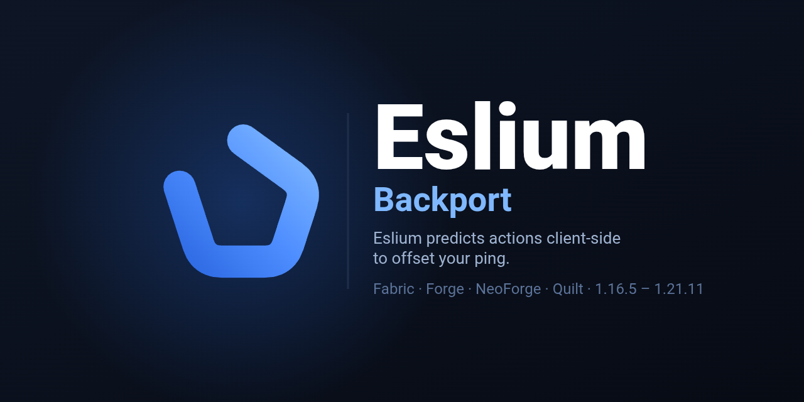

<center>



# Eslium

[](https://modrinth.com/project/zaVwh7an)
[](https://github.com/Solmeye/Eslium)
[](https://discord.gg/FVq3j5heAc)
[](https://youtube.com/@1szco1)

[](https://fabricmc.net/)
[](https://quiltmc.org/)
[](https://neoforged.net/)
[](https://files.minecraftforge.net/net/minecraftforge/forge/)

</center>

## What's Eslium ?

Eslium is a project to predict more things client-side.
For example, if you want to use a Crystal, you must wait for the server validation for it to appear.
This mod fixes that and therefore compensates for the ping.


## Cross-version ghosting

Predicted spawns are matched to authoritative packets by entity type and proximity rather than by exact coordinates and metadata, so a translated connection (for example a 1.16.5 client on a 1.21.11 server) retires its fake throwable instead of leaving a duplicate behind. Predicted spawn packets are never replayed, which also prevents ghost entities when the server changes the spawn data.

## Stability and performance

Predicted packets and their client-side entity clones are discarded when you leave a server, change worlds, or the mod becomes inactive, so nothing from an old connection can be replayed into a new one. Every prediction hook checks that the client world and the network handler's world are the same object before it runs, which removes the null-pointer crashes seen on disconnect and dimension changes. The simulated server tick is skipped entirely when no interaction is in flight, inventory snapshots reuse stack references instead of deep-copying them, ghost-anchor cleanup runs four times a second, and targeting stops re-raycasting once a ghost anchor is already aimed at. Authoritative block updates are applied as soon as they arrive instead of after a latency window, so a placement corrects itself in the same frame rather than lingering as a ghost block.

## Credits

### Anchor and explosion optimization references

The anchor path borrows ideas from these projects; thanks to their authors:

- [Anchor Optimizer by Walksy](https://github.com/Walksy/AnchorOptimizer) (MIT) — skip the client-side explosion when an entity occupies the anchor block; that check is used here. Its duplicate-sound suppression was not adopted.
- [Heros Anchor Optimizer by HerobaneNair](https://github.com/HerobaneNair/herosanchoroptimizer) (MIT) — ghost-anchor rendering reference; Eslium already had its own ghost anchors, so no code was taken.
- [Oushii by Paulem79](https://modrinth.com/project/n38thv95) (GPL-3.0-or-later) — precomputed blast-offsets idea; the glowstone sweep now uses a static offset table instead of recomputing the radius on every detonation.
- [Anchor-Optimizer by cutebow](https://github.com/cutebow/Anchor-Optimizer) — reference only; its source is all-rights-reserved, so no code was taken.


- **Original mod:** [Eslium on Modrinth](https://modrinth.com/project/zaVwh7an) by [@Solmeye](https://github.com/Solmeye)
- **1.21.11 port:** [@1szco1](https://github.com/1szco1)

## Predictions implemented

<details>
<summary>Minecarts</summary>

When using any type of minecart on a rail, the spawn of the minecart is predicted

</details>

<details>
<summary>End Crystal</summary>

When using an end crystal on obisidian or bedrock, the spawn of the end crystal is predicted

</details>

## Predictions Added so far:
- Consumables
- Cooldowns
- Crystals
- Elytras
- Firework
- Minecart
- Pose
- Swap
- Weapons
- Windcharge
- Throwables
- Placeables
- Interactables
- Tools
- Combat
- Redstone
- Anchors
- Placement


## Configuration

The mod can be configured **in-game** through [Mod Menu](https://modrinth.com/mod/modmenu) (optional dependency) or with the rebindable keybind **`key.eslium.open_config`** (unbound by default - set it in *Options → Controls*). The configuration is stored at `config/eslium.json`.

The in-game menu lists every prediction. Each entry has an on/off toggle on its right, and clicking the entry itself opens a sub-menu with the dedicated settings for that option (server types, timings, distances, and so on), so everything can be changed on click without editing the file.

Every prediction section shares the same base options:

- `enabled` - toggle this prediction
- `servers` - which server types it applies to (applies if **any** is enabled):
  - `CUSTOM` - servers using the Eslium protocol
  - `MODDED` - modded servers
  - `PLUGIN` - plugin-based servers
  - `VANILLA` - vanilla servers
- `maxTime` - maximum time in ms to keep a predicted (not yet confirmed) action alive
- `maxDistance` - maximum distance in blocks for the prediction (where applicable)

<details>
<summary>Default configuration</summary>

```
{
  "enabled": true,
  "optout": false,
  "debug": false,
  "experimental": false,
  "latencyMargin": 25,
  "version": 1,
  "safeMode": false,
  "simulatedDesync": 100,
  "consumables": { "enabled": false, "servers": { "CUSTOM": true, "MODDED": true, "PLUGIN": true, "VANILLA": true }, "maxTime": 5000, "maxDistance": 16 },
  "cooldowns": { "enabled": false, "servers": { "CUSTOM": true, "MODDED": true, "PLUGIN": true, "VANILLA": true } },
  "crystals": {
    "enabled": true,
    "servers": { "CUSTOM": true, "MODDED": true, "PLUGIN": true, "VANILLA": true },
    "maxTime": 5000,
    "delay": 0,
    "dynamicDelay": true,
    "resync": 20,
    "autoDestroy": { "enabled": true, "maxTime": 5000 }
  },
  "elytras": { "enabled": false, "servers": { "CUSTOM": true, "MODDED": true, "PLUGIN": true, "VANILLA": true }, "maxTime": 5000, "maxDistance": 16 },
  "firework": { "enabled": false, "servers": { "CUSTOM": true, "MODDED": true, "PLUGIN": true, "VANILLA": true }, "maxTime": 5000, "maxDistance": 16 },
  "minecart": { "enabled": true, "servers": { "CUSTOM": true, "MODDED": true, "PLUGIN": true, "VANILLA": true }, "maxTime": 5000 },
  "pose": { "enabled": false, "servers": { "CUSTOM": true, "MODDED": true, "PLUGIN": true, "VANILLA": true } },
  "swap": { "enabled": false, "servers": { "CUSTOM": true, "MODDED": true, "PLUGIN": true, "VANILLA": true } },
  "weapons": { "enabled": false, "servers": { "CUSTOM": true, "MODDED": true, "PLUGIN": true, "VANILLA": true }, "maxTime": 5000, "maxDistance": 16 },
  "windcharge": { "enabled": false, "servers": { "CUSTOM": true, "MODDED": true, "PLUGIN": true, "VANILLA": true }, "maxTime": 5000, "maxDistance": 16 },
  "throwables": { "enabled": false, "servers": { "CUSTOM": true, "MODDED": true, "PLUGIN": true, "VANILLA": true }, "maxTime": 5000, "maxDistance": 16 },
  "placeables": { "enabled": false, "servers": { "CUSTOM": true, "MODDED": true, "PLUGIN": true, "VANILLA": true }, "maxTime": 5000, "maxDistance": 16 },
  "interactables": { "enabled": false, "servers": { "CUSTOM": true, "MODDED": true, "PLUGIN": true, "VANILLA": true }, "maxTime": 5000, "maxDistance": 16 },
  "tools": { "enabled": false, "servers": { "CUSTOM": true, "MODDED": true, "PLUGIN": true, "VANILLA": true }, "maxTime": 5000, "maxDistance": 16 },
  "combat": { "enabled": false, "servers": { "CUSTOM": true, "MODDED": true, "PLUGIN": true, "VANILLA": true }, "maxTime": 5000, "maxDistance": 16 },
  "redstone": { "enabled": false, "servers": { "CUSTOM": true, "MODDED": true, "PLUGIN": true, "VANILLA": true }, "maxTime": 5000, "maxDistance": 16 },
  "anchors": {
    "enabled": true,
    "servers": { "CUSTOM": true, "MODDED": true, "PLUGIN": true, "VANILLA": true },
    "maxTime": 3000,
    "glowstoneSound": true,
    "clientExplosion": true,
    "reInteract": true,
    "ghostAnchor": true
  },
  "placement": {
    "enabled": true,
    "servers": { "CUSTOM": true, "MODDED": true, "PLUGIN": true, "VANILLA": true },
    "dynamic": true,
    "fixedWindowMs": 1000,
    "floorMs": 50,
    "capMs": 300
  }
}
```

</details>

<details>
<summary>Explanation</summary>

**Global options**

- `enabled` - enable or disable the whole mod
- `optout` - opts this client out of the Eslium protocol
- `debug` - print debug information to the log (only active while `enabled` is true)
- `experimental` - allow experimental predictions
- `latencyMargin` - ping in ms added to your estimated latency. Useful to avoid considering actions the server denies after a latency spike. Should represent the current latency fluctuation of your connection.
- `version` - configuration version. Do not touch!
- `safeMode` - reduces the likelihood of being flagged by an impossible anticheat. The probability is already low when disabled. Warning: this can lead to bizarre behavior.
- `simulatedDesync` - percentage (0-100) of the maximum client-server tick desynchronization time used to simulate vanilla desynchronization, which keeps the prediction statistically fair. In singleplayer this is effectively `0`, and against a local server it averages around `50`. Default `100`.

**Sections**

All sections below share `enabled`, `servers`, and (where shown) `maxTime` / `maxDistance`: `consumables`, `cooldowns`, `crystals`, `elytras`, `firework`, `minecart`, `pose`, `swap`, `weapons`, `windcharge`, `throwables`, `placeables`, `interactables`, `tools`, `combat`, `redstone`, `anchors`, `placement`.

- `crystals`
  - `delay` - fixed delay in ms before a hit crystal is hidden when `dynamicDelay` is off (0-200)
  - `dynamicDelay` - when enabled, the delay is estimated automatically from your latency instead of using `delay`
  - `resync` - number of ticks to hide/resync a real crystal before it is shown again (0-50)
  - `autoDestroy` - automatically remove the client-side crystal prediction after a delay
    - `enabled` / `maxTime`

- `anchors`
  - `glowstoneSound` - play the charge sound client-side
  - `clientExplosion` - show the detonation explosion client-side
  - `reInteract` - allow re-interacting with the anchor before the server confirms
  - `ghostAnchor` - hide a stale (ghost) anchor block

- `placement` - fixes block-placement "ghosting" (a placed block briefly reverting to its old state)
  - `dynamic` - derive the settle window automatically from your measured latency
  - `fixedWindowMs` - window used when `dynamic` is false
  - `floorMs` / `capMs` - lower/upper bounds for the dynamic window

</details>

## Disclaimer

Allowed on servers such as:
- `PvPClub`
- `FadedMC`
- `Turtled`
- `CatPvP`

Versions 4.0+ are designed not to trigger anticheats.
However, a bug is not inevitable, so it is still recommended to request authorization for this mod before using it on a server.

## FAQ
### How it works ?
This mod uses mixins to inject code into Minecraft code. During certain actions, if implemented, the behavior of a vanilla server is replicated on the client side. 

### Is this mod a cheat?
You might think this mod is a cheat because it gives an advantage to those who don't have it, and these kinds of mods often raise these kinds of questions.

Here are a few points :

- Some people naturally have lower ping, yet it is not considered cheating

- It is possible to have 0ms ping behavior in vanilla, but it is also possible to have it (as far as it is implemented) with any ping and Eslium.

- Some mods remain accepted by the community but their behavior is impossible to reproduce in vanilla.
I'm thinking in particular of Health Indicator, Armor HUD, AppleSkin, FreeCam, and Ok Zoomer.

- This mod has been accepted by Modrinth and some PvP servers.

- Sodium optimize FPS, Lithium optimize MSPT, Eslium optimize the ping's impact.

- Other ping's optimizer are allowed, such as Marlow's Crystal Optimizer, Hero's Elytra Optimizer, Consumable Optimizer or Anchor Optimizer

### Is this likely to break the desynchronization of the client-server tick loop?
No. This desynchronization is simulated by an artificial time delay of half a tick.

### Am I going to flag the anticheats?
This mod is designed to not trigger anticheats.
The way it works is by only adding the entities client-side when they are rendered and at the moment of their ticking, without letting them interacting with anything real.
So no, you won't if you use the recommended versions.

Note: I played for months with this mod and I have never been banned

### Which branch should I install?
- Release versions are safe to use

- Beta might behave weirdly but shouldn't flag any anticheat

- Alpha versions may be unstable and are only here to test the new functionnalities and fixes, regardless of their stability.

For a casual player, beta or release versions are recommended.

### Is Eslium available for other Minecraft versions?
Yes, a 1.16.5 backport is available.

## Compatibility
Eslium should work on any client.

## Support me!
Join my Hardcore Minecraft server: [HardcoreSMP](https://modrinth.com/server/hardcoresmp_) - `38.143.19.130`
